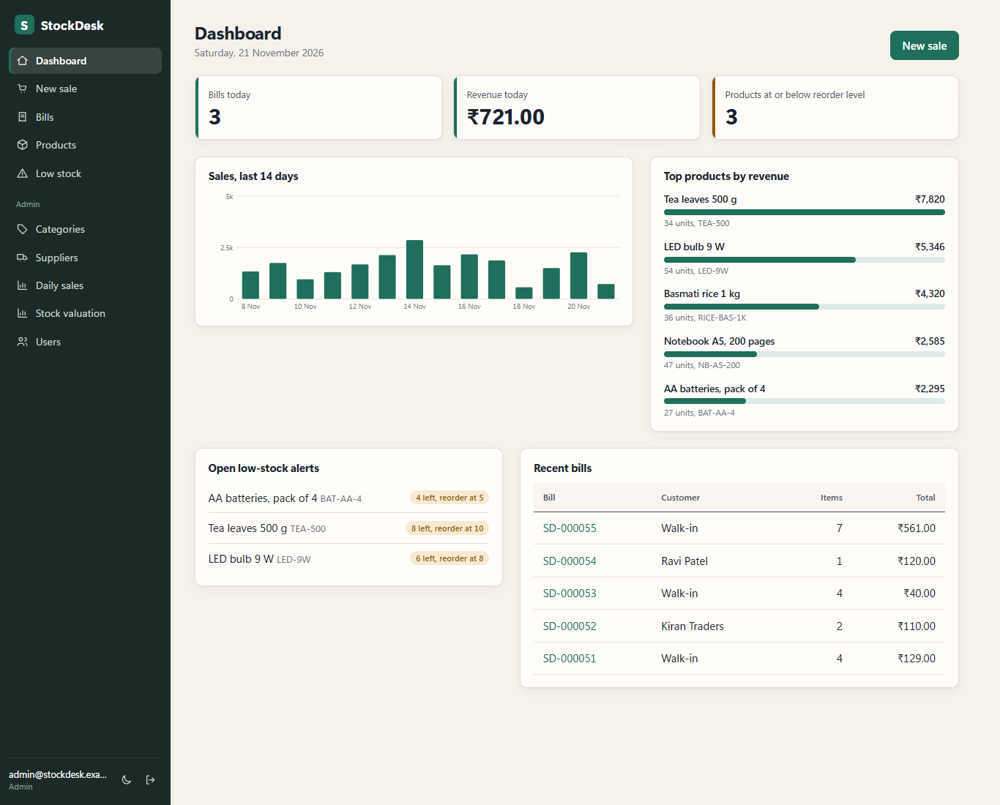
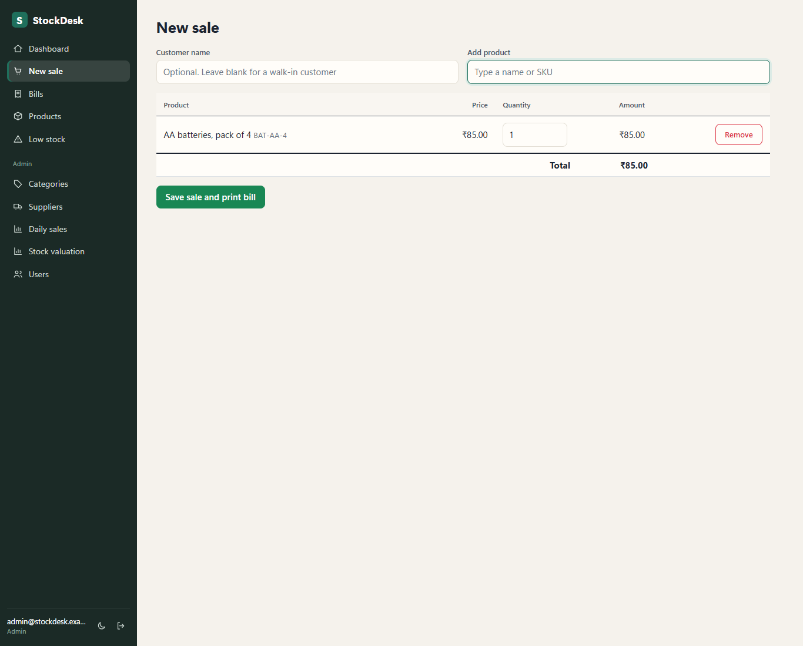
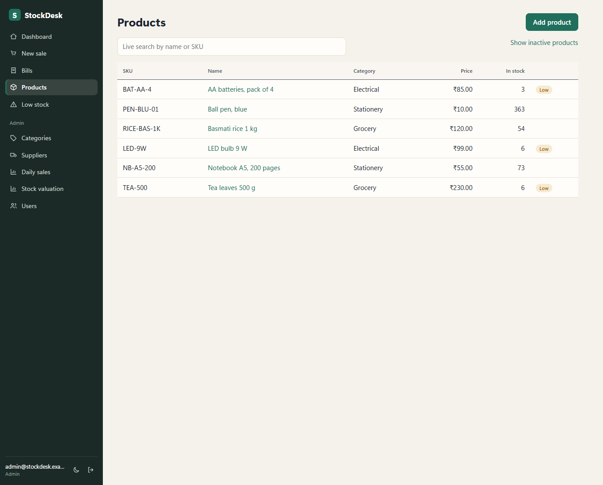
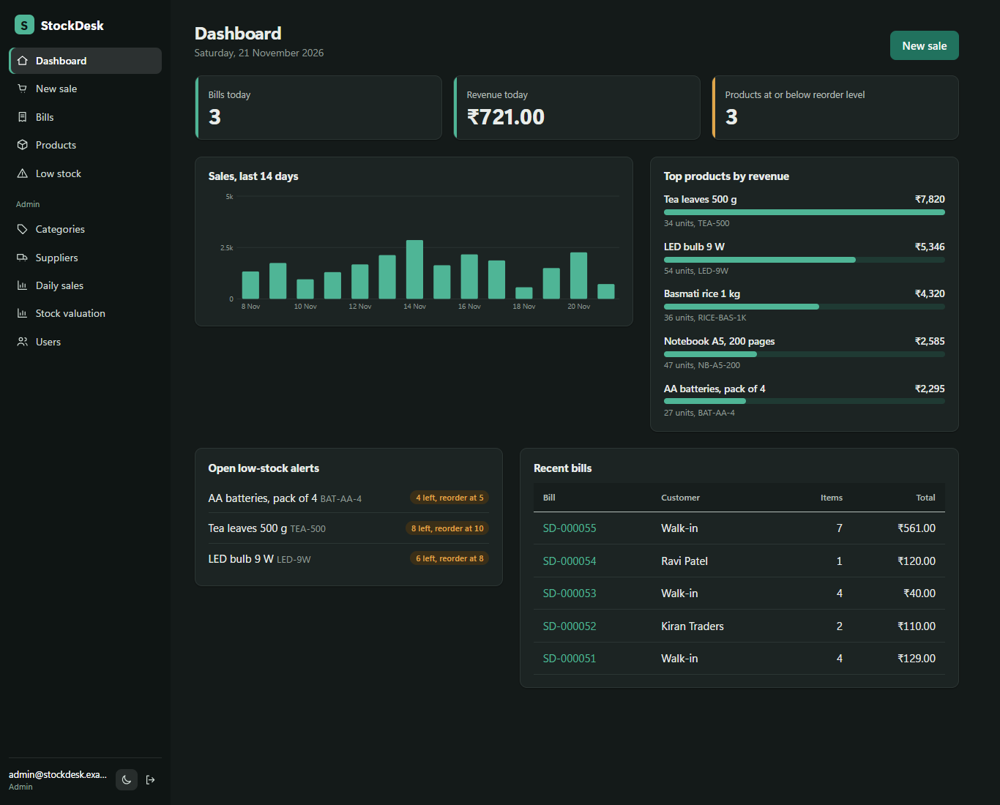
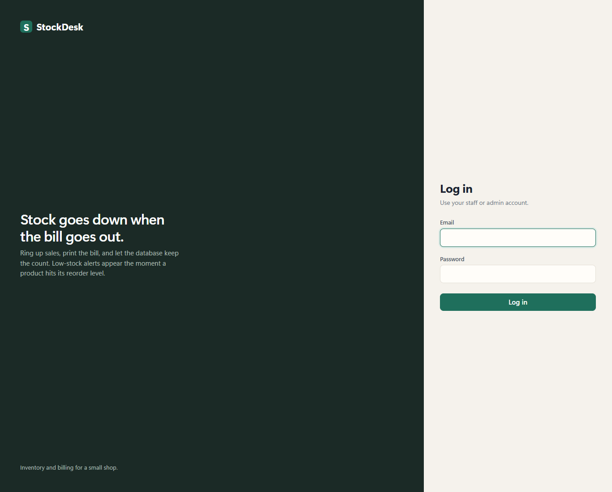
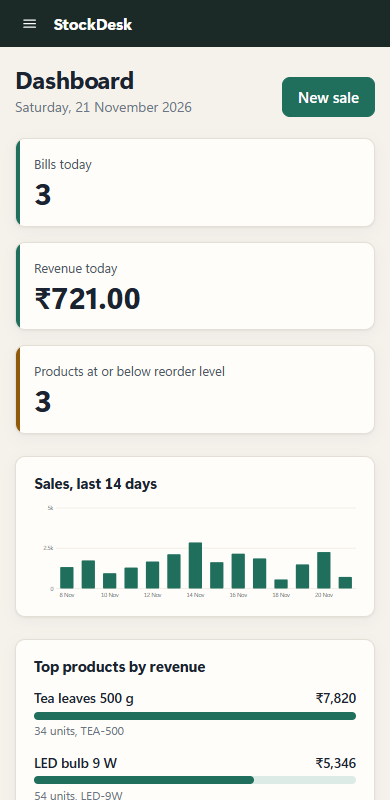
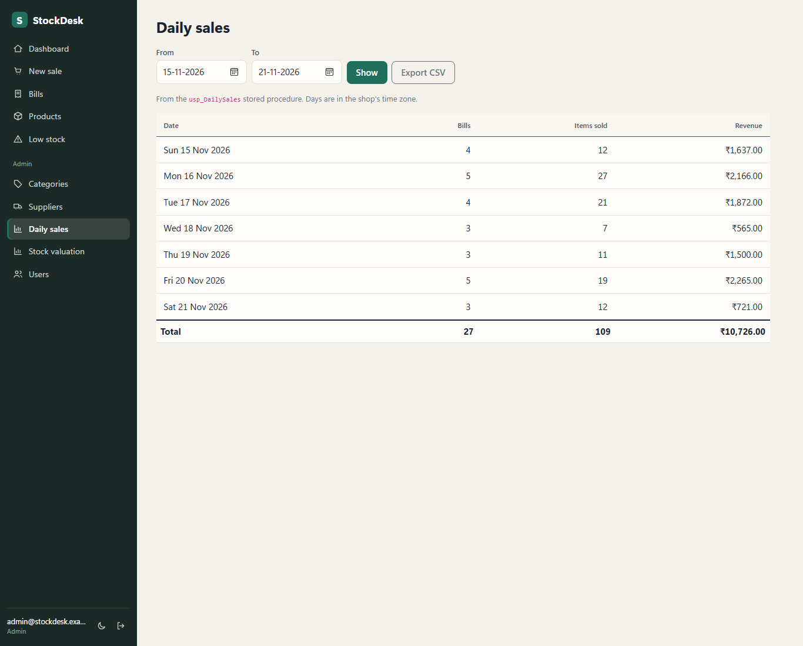
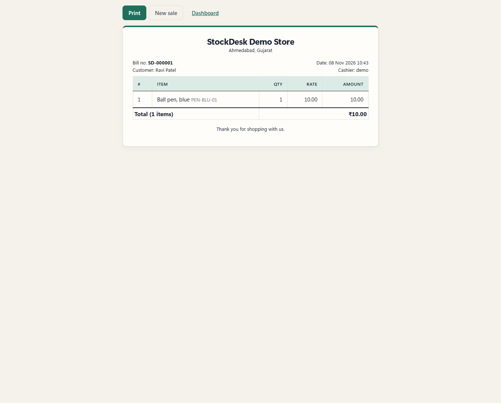

# StockDesk

[](https://github.com/AryaShah800/stockdesk/actions/workflows/ci.yml)

Inventory and billing web app for a small shop, built with ASP.NET Core MVC (.NET 8). Staff ring up sales and print bills; a SQL Server trigger takes the sold stock off in the same transaction and raises low-stock alerts; Admins manage the catalogue, users and the stored-procedure reports.

## Status

| Area | State |
|---|---|
| Catalogue, roles, billing, printable bill, live search, trigger, reports | Built and tested (`dotnet test`) |
| GitHub Actions CI ([.github/workflows/ci.yml](.github/workflows/ci.yml)) | Runs on every push and pull request to `main`: build (warnings are errors), vulnerable-package check, all unit and integration tests on `windows-latest` with LocalDB |
| Dashboard charts and CSV export | Built and tested: 14-day sales chart, top products, CSV for daily sales, stock valuation and top products (admin) |
| Tests | `dotnet test` on this branch: 179 passed (114 unit, 65 integration) |
| IIS deployment | **Not done.** The app has only been run locally with `dotnet run` |

| Dashboard | New sale (live search) |
|---|---|
|  |  |
| Products | Dark mode |
|  |  |
| Login | Mobile |
|  |  |
| Daily sales (with CSV export) | Printable bill |
|  |  |

The UI is a custom design system (`wwwroot/css/site.css`) on top of Bootstrap's grid: sidebar shell, ledger palette, tabular numbers, dark mode (remembered in the browser), responsive down to phone width. Screenshots are from the Docker demo data (`Seed__DemoData`: 6 products and 14 days of bills created through the normal sale path, so the stock trigger and low-stock alerts ran).

## Run it with one command (Docker)

Needs Docker only (no .NET SDK, no LocalDB).

```bash
cp .env.example .env        # compose refuses to start without it
docker compose up --build
```

Starts SQL Server 2022, then the web app, which applies the migrations, creates the Admin account from `.env` and loads the demo catalogue (`Seed__DemoData`). Open http://localhost:8089 (change with `WEB_PORT`) and sign in with `admin@stockdesk.example` / `Demo-Admin-2026!` (demo values from `.env.example`). Remove everything with `docker compose down -v`. The image is amd64 (SQL Server image).

## Tech stack

C# 12, .NET 8, ASP.NET Core MVC with Razor views, EF Core 8, SQL Server (LocalDB for development), T-SQL trigger and stored procedures, ASP.NET Core Identity (cookie login, Admin and Staff roles), Bootstrap 5, jQuery AJAX, xUnit, Moq, FluentAssertions, GitHub Actions.

## Architecture

Clean Architecture: dependencies point inwards.

```
src/
  StockDesk.Domain          entities and business rules, no dependencies
  StockDesk.Application     IRepository<T>, IUnitOfWork, use-case services, report contracts (no EF Core)
  StockDesk.Infrastructure  EF Core DbContext, repositories, unit of work, migrations, trigger and procedures, Identity seeding
  StockDesk.Web             MVC controllers, Razor views, jQuery, authorization policies
tests/
  StockDesk.UnitTests          domain rules and services (Moq for the unit of work)
  StockDesk.IntegrationTests   real migrations on a throwaway LocalDB database, and the hosted app via WebApplicationFactory
```

Choices worth knowing about:

- **Generic Repository and Unit of Work.** The Application layer only sees `IRepository<T>`, three specific repositories and `IUnitOfWork`, so services are tested with Moq and never reference EF Core. All repositories share one `DbContext`, and `SaveChangesAsync` writes everything in one transaction. Database errors the user can act on are translated into typed exceptions (oversold stock, duplicate SKU, row still in use, concurrent edit) and shown as form errors.
- **Stock goes down in the database, not in C#.** Saving a sale inserts its lines; the `trg_SaleLines_ReduceStock` trigger subtracts the quantities in the same transaction. The `UPDATE` locks the product rows, so two tills selling the last units queue up instead of both reading the old quantity. If any product would go below zero the trigger `THROW`s error 50001 and the whole sale is rolled back. The domain also checks stock first so the cashier gets a clear message in the normal case.
- **Low-stock alerts** are raised by the same trigger when a sale leaves a product at or below its reorder level. A filtered unique index allows at most one open alert per product; acknowledging it lets the next sale raise a new one.
- **Bills never change.** Each sale line copies the product name, SKU and price at the time of sale. Products are deactivated rather than deleted.
- **Concurrency.** Products carry a `rowversion`, so a restock or edit made from a stale copy (for example after a sale changed the stock) is rejected instead of overwriting the stock.
- **Reports** come from two stored procedures. `usp_DailySales` groups by the shop's local date (sales are stored in UTC; `Shop:UtcOffsetMinutes`, default 330 for India) and turns the date range into UTC bounds so the `SoldAtUtc` index can be used. `usp_StockValuation` values active stock per category at cost and at selling price.

## Features

| Page | Who | What |
|---|---|---|
| Dashboard | Admin, Staff | Bills and revenue today, products at or below reorder level, open alerts, recent bills |
| New sale | Admin, Staff | Live product search (jQuery AJAX against `GET /Products/Search?term=`), quantities, running total, save |
| Bill | Admin, Staff | Printable bill (`window.print()`, A5 print styles) |
| Products | Admin, Staff | List with live search; Admin adds, edits, restocks, deactivates |
| Low stock | Admin, Staff | Open alerts; Admin acknowledges |
| Categories, Suppliers | Admin | Razor CRUD; deleting one that is still used is refused |
| Daily sales, Stock valuation | Admin | Stored-procedure reports, each with an Export CSV button. Formula-looking cells are quoted so spreadsheets do not run them |
| Dashboard charts | Everyone | Server-rendered SVG: revenue per day (usp_DailySales, gaps filled with zero) and top 5 products by revenue (one EF query over bill lines) |
| Users | Admin | Create Admin or Staff accounts |

## Getting started

Prerequisites: .NET 8 SDK (see [global.json](global.json)), SQL Server LocalDB, and the EF Core CLI (`dotnet tool install --global dotnet-ef`).

The first Admin account is created at startup from two settings that are never committed. Set them once with user secrets:

```bash
dotnet user-secrets set "Seed:AdminEmail" "admin@example.com" --project src/StockDesk.Web
dotnet user-secrets set "Seed:AdminPassword" "<at least 10 characters, upper and lower case and a digit>" --project src/StockDesk.Web
```

Then create the database and run:

```bash
dotnet ef database update --project src/StockDesk.Infrastructure --startup-project src/StockDesk.Web
dotnet run --project src/StockDesk.Web
```

Optional: set `Seed:DemoData` to `true` to add three categories, a supplier and six products to an empty database. Setting `Database:MigrateOnStartup` to `true` applies migrations when the app starts instead of running `dotnet ef database update`.

## Configuration

| Setting | Purpose | Default |
|---|---|---|
| `ConnectionStrings:StockDesk` | SQL Server connection string | LocalDB, database `StockDesk` |
| `Seed:AdminEmail`, `Seed:AdminPassword` | First Admin account, created if missing. **Secret** | none |
| `Seed:DemoData` | Add sample catalogue to an empty database | `false` |
| `Database:MigrateOnStartup` | Apply EF Core migrations at startup | `false` |
| `Shop:Name`, `Shop:Address`, `Shop:Phone` | Printed on bills | demo values |
| `Shop:UtcOffsetMinutes` | Shop time zone for bills and the daily report | `330` |

## Security

- Every page needs a signed-in user unless it opts out with `[AllowAnonymous]` (only login and access-denied do). Admin pages use a role policy.
- Antiforgery tokens are validated on every POST.
- Passwords are hashed by ASP.NET Core Identity; accounts lock for 15 minutes after 5 failed logins.
- The login page only redirects to local return URLs.
- No secrets are in the repository. The CI build fails if a NuGet package with a known vulnerability is used.

Known limitations:

- No GST on bills: prices are treated as final. (GST invoicing is what [InvoiceHub](https://github.com/AryaShah800/invoicehub) does.)
- Returns, purchase orders and supplier payments are not implemented. Stock goes up only through Restock.
- One shop, one time zone, set by configuration.
- No password reset or email confirmation flow; an Admin creates accounts.

## Tests

```bash
dotnet test
```

- **Unit tests (114 cases):** product, sale, category, supplier and alert rules, and the product, sale, catalog and alert services with a mocked unit of work.
- **Integration tests (65 cases):** each class builds a throwaway LocalDB database from the real migrations and drops it afterwards, so LocalDB must be running. They cover the trigger (multi-line sales, a stale second till rolled back completely, low-stock alerts raised once until acknowledged, stale restock rejected), both stored procedures including local-date boundaries, repository search, error translation, the idempotent migration script applied twice to an empty database, and the web app through `WebApplicationFactory` (login, role checks, antiforgery, CRUD, AJAX search JSON, billing, reports, user creation).
- **Overselling under load:** one test fires 25 parallel one-unit sales at a product with 10 in stock. Exactly 10 succeed and stock ends at 0, never below.

To add a migration:

```bash
dotnet ef migrations add <Name> --project src/StockDesk.Infrastructure --startup-project src/StockDesk.Web --output-dir Persistence/Migrations
```

## Roadmap

- [x] Product, category, supplier and sale models with EF Core
- [x] Generic Repository and Unit of Work
- [x] Role-based login (Admin, Staff)
- [x] Razor CRUD views
- [x] T-SQL trigger: reduce stock on sale and raise low-stock alert
- [x] T-SQL stored procedures: daily sales, stock valuation
- [x] jQuery AJAX live product search
- [x] Printable bill
- [x] GitHub Actions CI: build and test on every push
- [ ] IIS deployment
